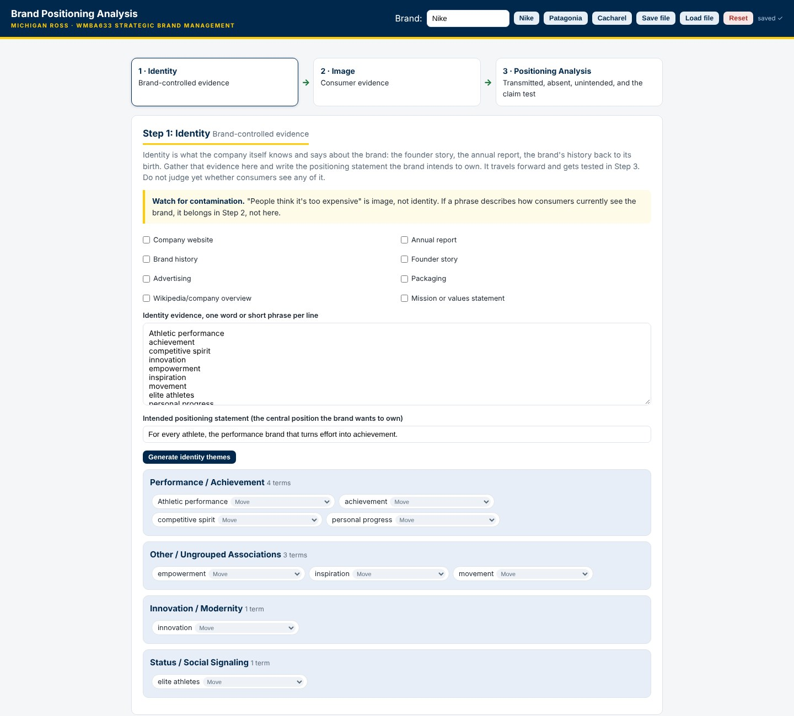

# Brand Positioning Analysis

Combines three separate positioning tools into one three-step flow: Identity, Image and Positioning Analysis.

**Open:** [`brand-positioning-analysis.html`](./brand-positioning-analysis.html). Download it and open it in any browser. No server or API key is needed.

## What it teaches

The gap between **brand identity** (what the company says about itself) and **brand image** (what consumers think).

1. **Identity.** Students collect brand-controlled evidence and group it into themes.
2. **Image.** Students do the same for consumer evidence.
3. **Positioning Analysis.** The tool compares the two against the intended positioning statement, separating associations that are transmitted, absent, unintended, or carried by the claim alone.

Students can move any phrase to a different theme. Built-in examples cover Nike, Patagonia and Cacharel. Projects can be saved to a JSON file and reopened, for example to submit for grading.

## Course context

Strategic Brand Management (Prof. Katherine Burson). Developed summer 2026.

## How it was made

Prof. Burson built the three original tools herself with ChatGPT. This version was built with an AI coding assistant: it chains them so data carries between steps instead of being copied across three files, and it adds design changes for smoother interaction.

## Known issues

- Theme grouping is rule-based and intentionally transparent, not AI-generated. Students are expected to challenge and regroup.
- The themes for the three built-in examples are preconfigured. For a new brand, students build their own.
