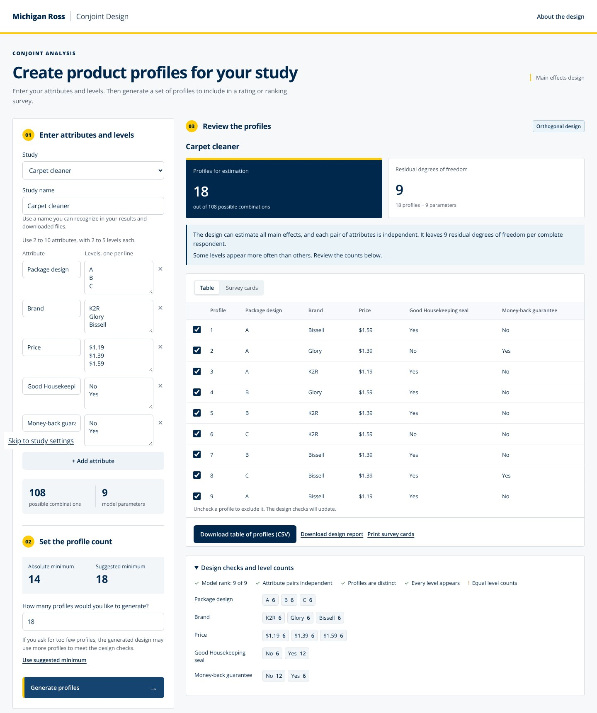

# Conjoint Design Studio

A browser tool that generates the product profiles students need for a classroom conjoint study.

**Open:** [`conjoint-design-studio.html`](./conjoint-design-studio.html). Download it and open it in any browser. No installation or server is needed, and nothing is uploaded.

## Concept taught

Conjoint study design: choosing attributes and levels, understanding how many profiles a main-effects design needs, and checking that a design can estimate every attribute independently.

Students enter their attributes and levels, or start from the carpet-cleaner or Amazon Echo examples. The tool shows the **absolute minimum** (1.5 × parameters, rounded up) and **suggested minimum** (2 × parameters) number of profiles under the course rules, then generates a balanced design. Design checks confirm full rank, distinct profiles, every level appearing and attribute pairs varying independently. Students can exclude profiles and see the checks update.

Outputs: a table of profiles (CSV), a design report, and printable survey cards, all named after the study.

## Course

Pricing course of Prof. Aradhna Krishna. Final version delivered October 2026, before the course began.

## How it was built

Built with an AI coding assistant over several feedback rounds with Prof. Krishna. Prompt summary: a single-file browser app for categorical main-effects conjoint designs that enforces the course's minimum-profile rules, never silently reduces them, generates a near-orthogonal design, and exports a CSV, a report and printable cards, with plain student-facing language and no technical construction details.

## Known limitations

- Supports categorical main-effects designs only, with no interaction terms.
- If the full factorial is smaller than the suggested minimum, the tool uses all distinct combinations and explains why. If it is smaller than the absolute minimum, generation is blocked.
- Printing to PDF from the browser's native print dialog has not been fully verified across browsers.
