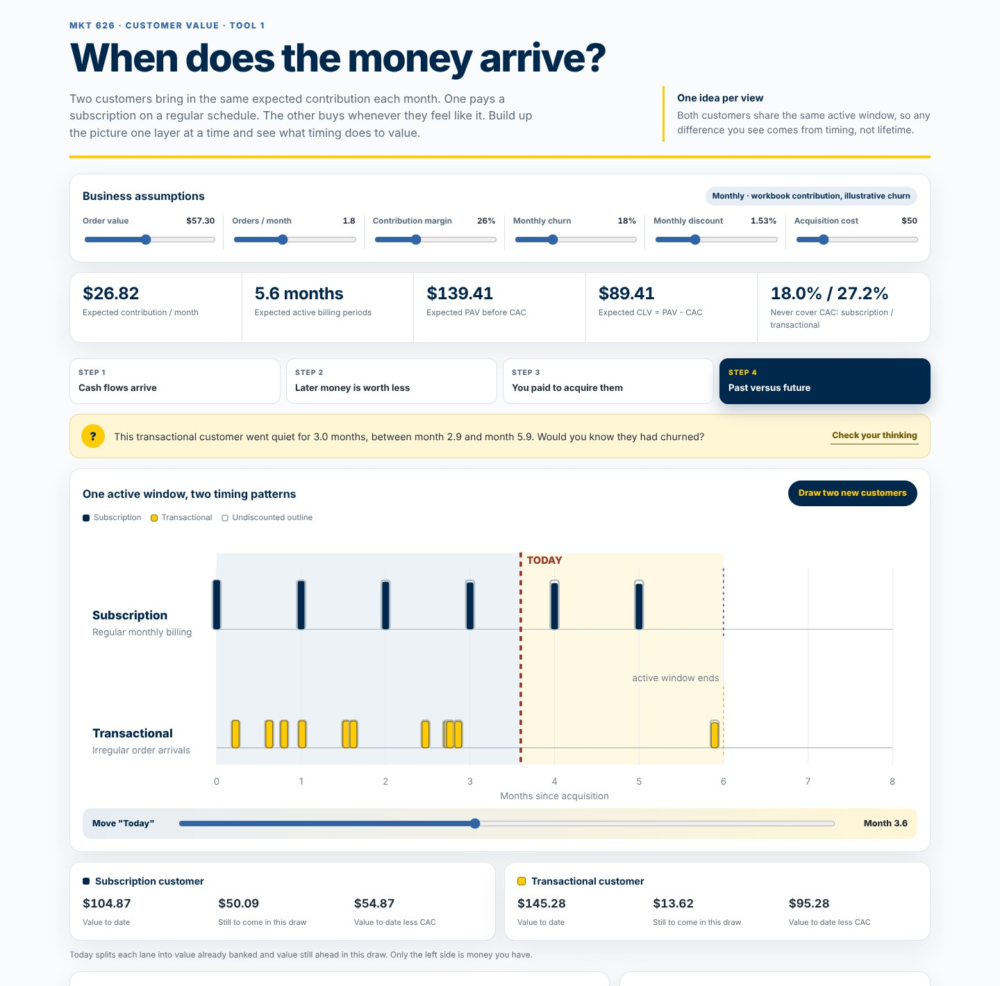
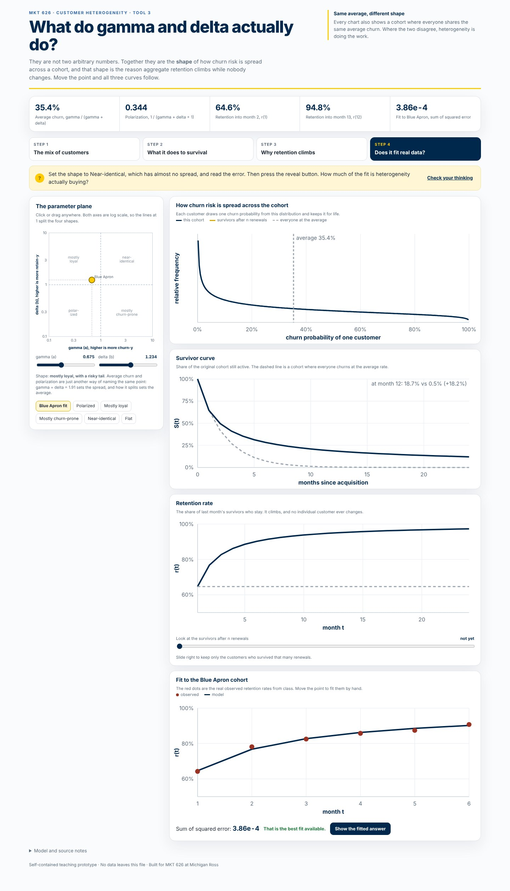

# Customer Lifetime Value Tools

Four step-by-step interactive tools for customer-base analysis and customer lifetime value (CLV). They use the Class 7 Blue Apron workbook numbers, so students can check everything on screen against the spreadsheets they built.

Each tool is a single HTML file. Download it and open it in any browser. No network connection is needed, and the files can go on Canvas as-is.

| File | What it shows |
|---|---|
| [`clv-cash-flow-timeline.html`](./clv-cash-flow-timeline.html) | **When does the money arrive?** Two customers with the same expected monthly contribution, one on a subscription and one buying irregularly. Four steps add discounting, acquisition cost (CAC) and payback, and a movable "Today" that separates value to date from value still ahead. |
| [`clv-table-to-distribution.html`](./clv-table-to-distribution.html) | **From survivor table to CLV distribution.** One survivor table drives the survivor curve, CLV by lifetime and the CLV distribution. Hovering a row highlights the same lifetime in all three charts. |
| [`bg-parameter-plane.html`](./bg-parameter-plane.html) | **What do gamma and delta actually do?** A clickable parameter plane for the beta-geometric model. Students see how the mix of loyal and churn-prone customers drives survival and retention, then try to fit the Blue Apron data by hand before revealing the Solver answer. |
| [`coin-shakeout.html`](./coin-shakeout.html) | **Coin shake-out.** Prof. Schwartz's demo of how heterogeneity makes cohort retention rise over time, extended to plot the beta-geometric and retention curves, with a Blue Apron preset and a retention-rate view. |

## Concept taught

Customer heterogeneity, cohort survival and retention, discounting, CAC and payback, and the distribution of CLV across customers.

## Course

MKT 626, Customer Analytics: Measuring and Managing Customer Value (Prof. Eric Schwartz). Developed August 2026.

## How it was built

Built with an AI coding assistant from the course slides and workbooks. The math core of each tool was recomputed against `Class 7 - BG and CLV.xlsx` and checked with regression tests. Prompt summary: focused, progressive teaching tools in Michigan maize and blue, with a prediction question before each reveal and every chart traceable to a table row or formula. The coin shake-out starts from Prof. Schwartz's own prototype.

## Known limitations

- Monthly periods and annuity-due subscription timing are used throughout.
- The transactional customer's purchases follow Poisson arrivals, stated as a teaching assumption.
- Open decisions for Prof. Schwartz: Canvas versus GitHub Pages for distribution, and whether to mark the two-segment fit from the Class 7 slides on the parameter plane.

