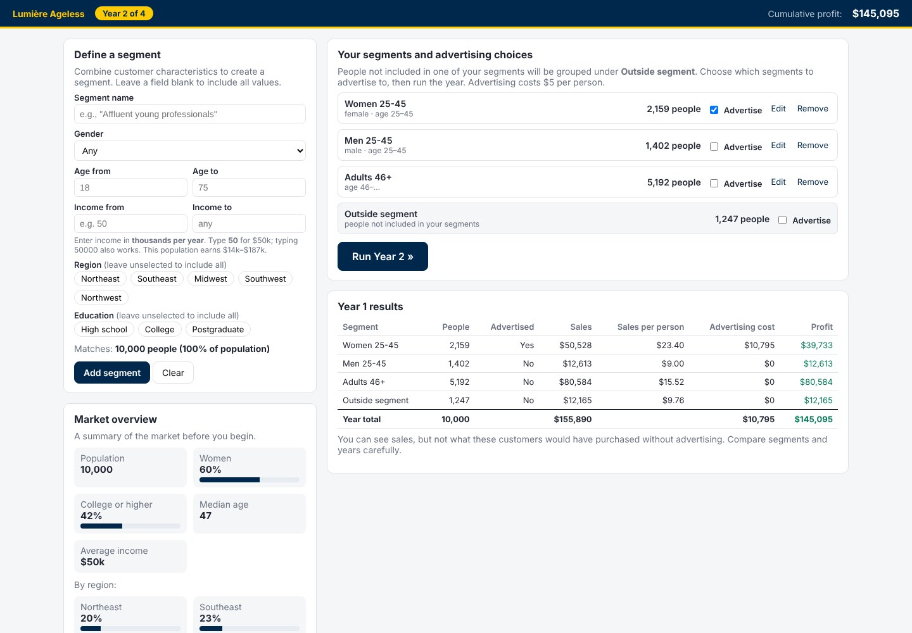
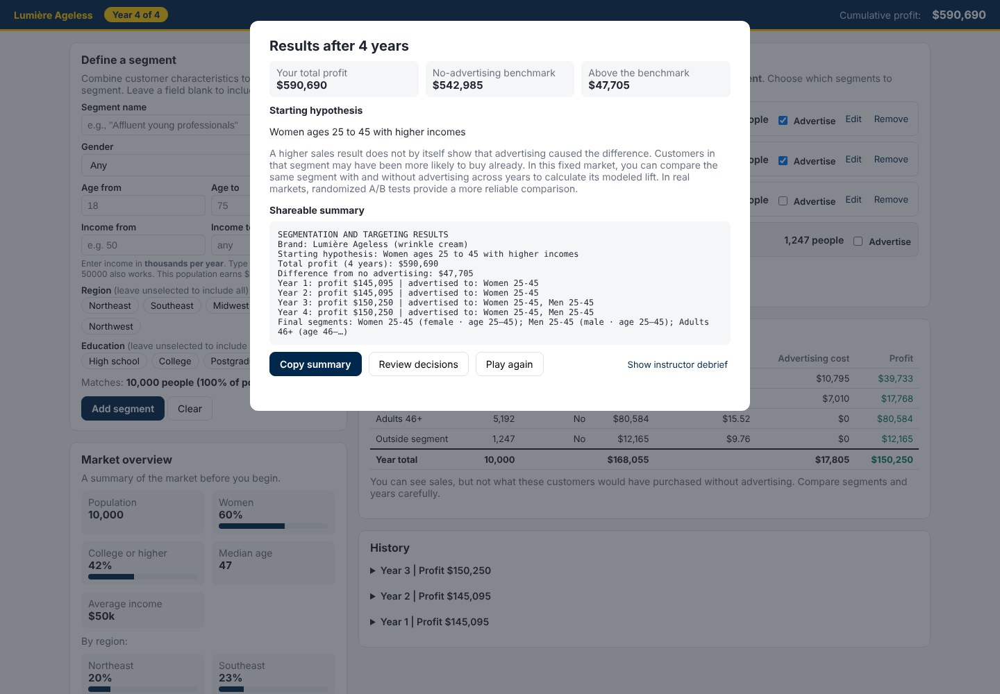

# Segmentation & Targeting Game

A 20–30 minute in-class simulation. Students split a simulated market of 10,000 consumers into segments, choose which segments to advertise to, and try to maximize profit over four rounds.

**Open:** [`segmentation-targeting-game.html`](./segmentation-targeting-game.html). Download it and open it in any browser. It needs no server, login or API key, and it can be posted to Canvas.

## Concept taught

- Building mutually exclusive (MECE) segments from demographics: gender, age, income, region and education
- Targeting decisions under an advertising cost
- The selection-versus-treatment confound: segments that look like better customers may simply buy more anyway, so ad effects are overstated when ads are targeted
- Why a few rounds of observational data are hard to learn from, which sets up A/B testing later in the course

Students see sales and profit by segment, never the true ad lift. The final screen gives a shareable result summary and an optional instructor debrief that reveals the underlying model.

## Course

MKT 300 (core marketing) and the Master of Management marketing core. Developed with Prof. Justin Huang, summer 2026.

## How it was built

Built with an AI coding assistant from Prof. Huang's verbal spec and his two example teaching apps. Prompt summary: a single self-contained HTML game with a fixed, generated population of 10,000 individuals; a hidden, deterministic model that produces base sales and advertising lift; segment builder with live counts and overlap checks; four rounds of binary advertise decisions; and an instructor-only reveal. All tunable values (story text, coefficients, ad cost, rounds, seed and noise) are in a `CONFIG` block at the top of the script, so faculty can edit them with AI.

## Known limitations

- Outcomes are deterministic by default (`noiseSD: 0`). A student who switches advertising on and off for the same segment across rounds can recover the true lift exactly. The debrief frames this as experimental thinking; add noise in `CONFIG` if you want to prevent it.
- The population and model are fictional and calibrated for teaching, not estimated from real data.
- Income is entered in thousands. Values of 1,000 or more are converted automatically from dollars.

