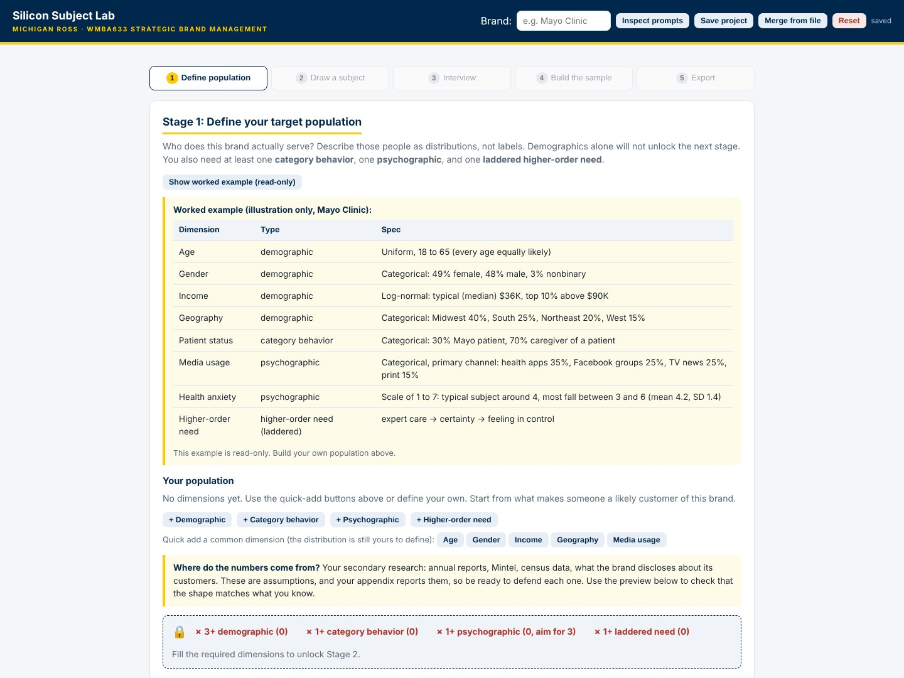

# Silicon Subject Lab

Guides students to build and interview synthetic consumer participants ("silicon subjects"), one at a time, for a brand audit.

**Open:** [`silicon-subject-lab.html`](./silicon-subject-lab.html). Download it and open it in any browser. It costs nothing to use: the tool writes the prompts, and students paste them into their own ChatGPT. No API key is needed.

## Concept taught

Synthetic sampling for consumer research, and its main failure mode: AI-generated respondents that all answer like the average consumer (mean regression).

The tool has five steps:

1. **Define population.** Students describe their target market as distributions, not labels. They need demographics plus at least one category behavior, one psychographic and one laddered higher-order need. Labels like "Gen Z" or "busy moms" are rejected.
2. **Draw a subject.** Each subject is sampled in the browser from those distributions instead of letting the AI choose a "typical" person.
3. **Interview.** Students interview one subject at a time with open-ended, word-association or laddering questions.
4. **Build the sample.** A variance monitor flags when answers start collapsing toward the average.
5. **Export.** Findings for the report body, plus instruments and method for the appendix.

## Course

Strategic Brand Management (Prof. Katherine Burson), for the brand audit final project. Developed summer 2026.

## How it was built

Built with an AI coding assistant from Prof. Burson's Brand Image lecture (the four-step silicon sampling workflow), the Becker/Maastricht respondent generator she used as a reference, and her brand audit assignment. Prompt summary: a one-person-at-a-time synthetic participant builder that requires segmentation before generation, samples subjects locally from student-specified distributions, composes prompts for the student's own ChatGPT, and exports audit-ready findings.

## Known limitations

- Step 1 asks students to specify distributions, including standard deviations for attitudes. Students without a statistics background may need a short explanation, or can anchor these to their own data collection.
- Laddered higher-order needs use the `→` symbol between levels (for example, `expert care → certainty → feeling in control`).
- The required dimensions in step 1 are set in the file and are not yet adjustable from the interface.
